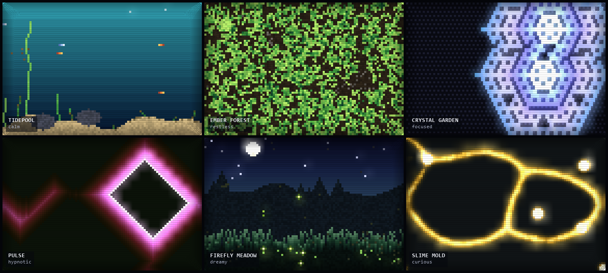

# Terrarium

A little shelf of six living pixel environments: a digital desk garden for a side screen.

Each environment is a 96×64 world with its own physics and its own mood. Each one runs a loop where growth and decay
pull against each other, so it never fills up and never dies out. It just keeps moving.



## Run

```powershell
cd D:\playground\claude\terrarium
..\scribblefall\.venv\Scripts\python.exe terrarium.py          # 2×2 shelf
..\scribblefall\.venv\Scripts\python.exe terrarium.py --mini   # frameless, always-on-top, bottom-right corner
..\scribblefall\.venv\Scripts\python.exe terrarium.py --headless 3000   # vital signs, no window
```

(Reuses the Scribblefall venv; anywhere else: `pip install pygame-ce`.)

## Portable build (USB stick)

```powershell
powershell -ExecutionPolicy Bypass -File devuild_portable.ps1
```

This makes `dist\Terrarium\` (about 34 MB) and `dist\Terrarium-portable.zip` (about 14 MB). Copy the folder to a stick and run
`Terrarium.exe`, or `Terrarium mini.cmd` for the corner widget. The other PC needs no Python and no install.
It's a PyInstaller *folder* build on purpose: a one-file exe would unpack itself into the host's `%TEMP%` on every
launch, while the folder runs straight off the stick. Screenshots go to `shots\` next to the exe, so they're on the stick too.
Only the build machine needs [uv](https://docs.astral.sh/uv/).

## The environments

| | mood | the loop |
|---|---|---|
| **Tidepool** | calm | kelp grows toward the light, ages and rots → rot sinks as detritus → composts the sand → rich sand sprouts new kelp (only where it isn't crowded). Fish graze the rot; bubbles rise from rich sand and leaves; caustic light shimmers near the surface. |
| **Ember Forest** | restless | trees spread from neighbours and darken as they age → lightning and drifting embers start fires that race downwind (older trees burn more readily) → ash crumbles back to soil. Population swings between ~1k and ~4k trees: boom, burn, regrow. |
| **Crystal Garden** | focused | Packard snowflakes on a hex lattice: an empty cell freezes if its count of frozen neighbours is in this bloom's rule. Each bloom picks a rule, colour family and seed layout, grows, holds, then melts from the tips or from the heart, and a new one begins. |
| **Pulse** | hypnotic | a Greenberg–Hastings excitable medium: cells fire, then rest. Propagation slowly drifts between perfect (crisp geometric diamonds) and lossy (fronts break and curl into self-sustaining spirals). The colours drift through the hue wheel over minutes. |
| **Firefly Meadow** | dreamy | pulse-coupled oscillators: every flash nudges nearby fireflies closer to flashing. Coupling waxes and wanes, so the meadow drifts from scattered twinkling to waves of light rolling across the grass → fireflies that flash together lay glowing eggs in the grass → eggs hatch, old fireflies fade. Stars twinkle, grass sways under the moon. |
| **Slime Mold** | curious | Physarum: hundreds of agents sniff the scent ahead, turn toward the strongest and leave scent behind, knitting a vein network between oat flakes → feeding makes it grow → when the oats run out it starves and pulls back → new oats fall. The veins slowly breathe (shuttle streaming). |

## Controls

| | |
|---|---|
| click | poke the world: feed the pool, start a fire / plant trees, seed a crystal, drop a pulse, release fireflies, drop an oat flake |
| double-click a tile · Tab | open it · back to the shelf |
| ← → / wheel | switch environment (single + mini) |
| M | mini mode (drag to move, right-click to poke) |
| T · O | always-on-top · opacity (100 / 80 / 55%) in mini mode |
| A | auto-cycle environments every 90 s |
| L · N | scanlines + vignette · labels |
| R · Space · S | reseed · pause · screenshot to `shots/` |

## How it's put together

- Every environment subclasses `Env`: it owns a 96×64 `bytearray` of **palette indices** and a 256-colour palette.
  The renderer hands that buffer straight to an 8-bit surface, so there's no per-pixel Python in the draw path.
- Animation is mostly **palette work**: fire flicker, caustics, crystal colour flowing outward and hue drift all
  change a few palette entries per frame, not pixels. That's how 8-bit-era games did it too.
- Bloom: each env lists its glowing palette indices; a glow-only copy is shrunk to ¼ and stretched back with
  additive blending.
- Each env runs at its own `tempo` (steps/sec): Crystal breathes at 14, the forest at 24. Together they use well
  under 10% of one CPU core.
- Slime Mold blurs its scent map without a per-pixel loop: the bytes are packed into 16-bit lanes of one big
  Python integer, and shifted copies of it are added together.
- Adding an environment is one class: `step()`, `animate(t)`, optionally `poke()`, `frame()` (for sprites like
  fish and embers) and `vitals()` (for the headless check). Then add it to `ENVIRONMENTS`.
